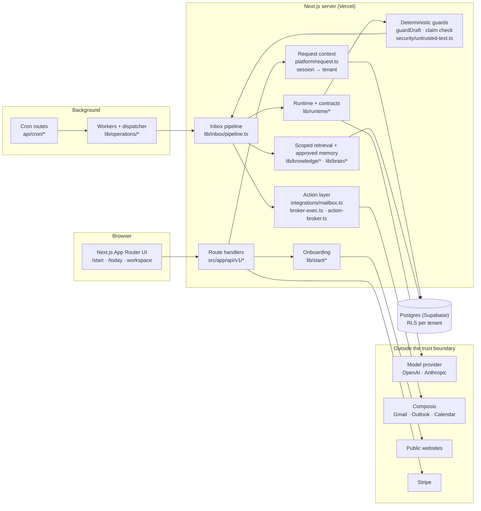
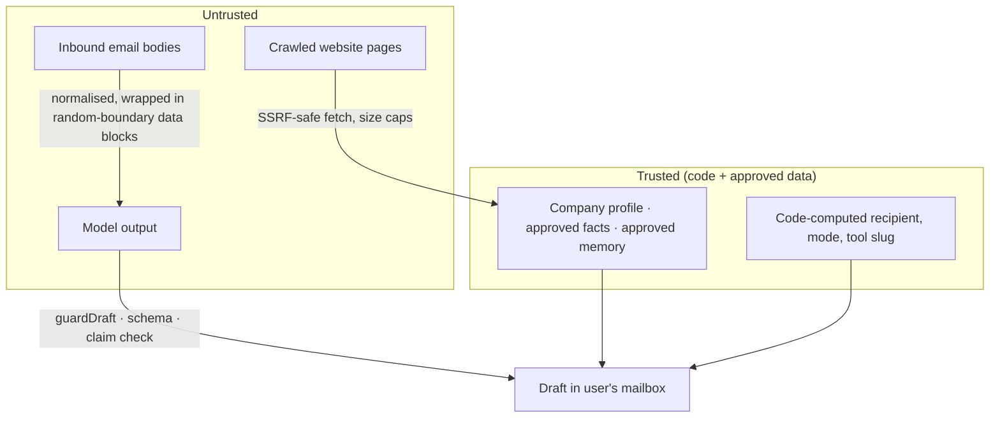

# Architecture

Orbis is an **agent harness** for small companies. The hard part is not getting a model to produce text. It is making sure that what reaches the customer's mailbox is bounded, grounded and reversible. Each business task runs against a versioned contract: what the agent may read, what it must produce, what it must never do, and which checks its output has to pass. The model is a component inside that harness. It is never the one in control.

This page describes the code as it is today. Target-state design documents (mostly in French) live in [`docs/architecture/`](docs/architecture/CTO-README.md). Where they differ from the code, the code wins; the main gaps are listed at the end of this page.

## System at a glance

## Components

| Component | Code | Responsibility |
| --- | --- | --- |
| Web app and API | `src/app/`, `src/app/api/v1/*` | UI surfaces and JSON route handlers. Every workspace route goes through `withWorkspaceRequest` (`src/lib/platform/request.ts`). |
| Platform | `src/lib/platform/*` | Supabase auth, tenant resolution, Postgres transactions with RLS context (`db.ts`), rate limits, cron guard, security headers, observability (Sentry envelope + allow-listed JSON logs). |
| Onboarding (`/start`) | `src/lib/start/*` | Four steps: company, account, mailbox, drafts. Crawls the public site through an SSRF-safe fetch, extracts a company profile, connects the mailbox, queues the first draft batch. |
| Inbox pipeline | `src/lib/inbox/*` | The production mission: triage inbound email, prepare reply drafts, attach evidence, never send. |
| Runtime and contracts | `src/lib/runtime/*` | Provider selection, structured generation with zod schemas, the inbox contract, the mission lab loop (plan → draft → review → repair), a local demo model for CI. |
| Knowledge and memory | `src/lib/knowledge/*`, `src/lib/brain/*` | Retrieval scoped to the sources a mission version allows; memory and company facts that only count once a human approves them. |
| Action layer | `src/lib/integrations/*` | The only code that touches third-party tools. Closed tool allow-lists, pinned tool versions, idempotent draft ledger. |
| Operations | `src/lib/operations/*`, `src/app/api/cron/*` | Leased background jobs: inbox batches, task runs, the dispatcher, retention and the daily digest. |
| Billing | `src/lib/billing/*` | Trial and plans state machine, Stripe checkout and webhooks, per-message budget reservation before any model call. |
| Catalog | `src/lib/capabilities/registry.ts`, `src/lib/product/*` | Versioned capability packages and the product surfaces built on them. |

## The harness contract

A capability is a versioned package (`CapabilityPackage` in `src/lib/domain/types.ts`, catalog in `src/lib/capabilities/registry.ts`). It declares its outcome, inputs and outputs, required knowledge, external effects, approval points, failure modes and a cost bound. A **mission** pins a package slug and version. Its **mission version** fixes the instructions, allowed knowledge sources, tools, operating mode and budget.

The contract that runs in production today is the inbox contract, `INBOX_CONTRACT` (`inbox-replies@1`) in `src/lib/runtime/inbox-replies.ts`. Expressed as role, objective, context, tools, must and cannot:

| | Inbox replies |
| --- | --- |
| Role | Prepare replies to customer and quote requests for a small business. |
| Objective | A reply draft in the user's own mailbox, ready to review. |
| Context | Company profile, approved facts, the mission's selected sources, at most 5 retrieval hits (`src/lib/inbox/context.ts`). |
| Tools | None for the model. Code chooses the recipient and calls the mailbox. |
| Must | Classify first, cite only trusted sources, and turn every missing fact into an explicit `[[À CONFIRMER]]` question. |
| Cannot | Send, invent prices, dates, deadlines, contacts or commitments, or follow instructions found inside an email. |

How it is enforced:

- **Versioning by hash.** Every lab run records a `policyHash` over the package version, mission version, sources, approved memory, instructions, provider and model (`contextSnapshot`, `src/lib/runtime/agent-engine.ts`). If the context changes mid-run, the run cannot be accepted. Inbox drafts carry the mission version inside their idempotency key (`draftIdempotencyKey`, `src/lib/inbox/pipeline.ts`).
- **Schema-bound output.** Every model call uses `generateText` with `Output.object(zodSchema)`, `maxRetries: 0` and an abort timeout. Output that fails the schema is treated as a model failure.

## Eval gates

Gates run in code, after the model and before anything reaches the user.

**Inbox pipeline** (`processMailboxBatch`, `src/lib/inbox/pipeline.ts`), per message:

1. **Deterministic skip.** No-reply senders, own messages, bulk mail and threads already answered never reach a model (`skipReason`).
2. **Budget reservation.** Spend is reserved before classification or drafting. When the cap is reached, the batch stops.
3. **Classification.** Only the actionable classes (`customer_request`, `quote_request`) get a draft.
4. **Recipient integrity.** Code computes the recipient (`replyRecipient`). A Reply-To that diverges, or a recipient that does not match, downgrades the draft to `needs_review`.
5. **`guardDraft`.** Amounts, emails, URLs, domains, phone numbers, dates and delays that do not appear in a trusted source are rewritten as placeholders. Commitments, free offers and discounts are flagged. Invalid citations are dropped, and injected placeholder syntax is neutralised.
6. **Meeting validation.** Proposed slots are checked against real free/busy data (`validateMeetingDraft`, `src/lib/calendar/slots.ts`).
7. **Claim check (optional).** A second model reviews only the quotes that appear verbatim in the draft and adds reviewer questions (`runClaimCheck`, `src/lib/inbox/claim-check.ts`, flag `ORBIS_INBOX_CLAIM_CHECK`).

**Mission lab loop** (`runTest`, `src/lib/runtime/agent-engine.ts`): plan → draft → review, with one repair pass. `evidenceChecks` (`src/lib/runtime/contracts.ts`) requires:

- every citation excerpt present verbatim in a selected source;
- coverage, grounding and safety verdicts from the reviewer;
- an unchanged context hash and no blocked plan.

A run with any failed check stays in `waiting_input`, and `applyFeedback` refuses to accept it.

## Trust boundaries

- **Tenant isolation.** The tenant comes from the Supabase session and the `memberships` row, never from the client. `setTenantContext` sets transaction-local `app.tenant_id`. Tenant tables use `ENABLE` + `FORCE ROW LEVEL SECURITY`. In production, `transaction()` refuses superuser and `BYPASSRLS` roles. PostgREST grants are revoked (`migrations/015-supabase-hardening.sql`), so Supabase serves auth only.
- **Untrusted text.** `src/lib/security/untrusted-text.ts` applies selective NFKC, strips invisible and bidi characters, re-fangs defanged links, and detects contacts and amounts with Unicode-aware patterns. Prompts wrap data in per-call random-boundary blocks (`dataBlock`) under fixed `SECURITY_RULES`.
- **Network egress.** Crawling goes through `fetchPublicResource` (`src/lib/runtime/company-site.ts`): HTTPS only, DNS resolution on every redirect hop, private ranges rejected, the resolved IP pinned, and response size capped.
- **Tool access.** The mailbox layer exposes a closed `MAILBOX_TOOLS` map. A forbidden-slug check runs at import time and on every call (`assertMailboxPolicy`). Tool versions are pinned. Calendar and label calls use `verifiedExecutor` (`broker-exec.ts`), which checks that the connected account is enabled, active and private before executing.
- **Runtime modes.** `test` simulates writes and returns a `simulated:` receipt; `scoped_autonomy` creates real drafts in the user's mailbox. Neither sends. The mode comes from server configuration (`ORBIS_INBOX_MODE`, default `test`), never from the model.
- **Secrets.** Provider keys and Composio credentials stay server-side. The model never sees them.

## Memory and retrieval

- **Scoped retrieval.** `accessibleSources` keeps only sources from the same tenant that are listed in the mission version, `ready`, and (for remote sources) verified within the last hour. `retrieveKnowledge` ranks them lexically (BM25-style), capped at 50 results (`src/lib/knowledge/retrieval.ts`).
- **Approval-gated memory.** Feedback creates `proposed` memory. Only an owner or admin can approve it (`PATCH /api/v1/memory/[id]`). `resolveApprovedMemory` applies scope rules (general rule, this customer, this result) and validity windows. When two approved items conflict, both are blocked rather than one picked.
- **Company brain.** Facts extracted from sent mail move from candidate to approved, rejected or superseded (`src/lib/brain/facts.ts`). Approval happens only in `reviewFact`, under an advisory lock, and only approved facts reach a prompt.

## Idempotent actions and background work

- **Draft ledger.** Each draft creation is claimed in a `DraftLedger` keyed by batch, message and mission version, with retry, record and "uncertain" reconciliation and at most 3 attempts (`src/lib/integrations/mailbox.ts`). Replaying a batch never duplicates a draft.
- **Generic action broker.** `prepareAction` / `executeAction` (`src/lib/integrations/action-broker.ts`) hash arguments canonically, require that the approved payload hash matches, claim the idempotency key and require a pinned tool version. Tests cover it, but no production path calls it yet; it is the gate for future external writes such as sending email.
- **Leased jobs.** Workers claim rows with `FOR UPDATE SKIP LOCKED`, hold a lease that is renewed per message, retry with backoff and allow one running batch per workspace (`src/lib/operations/*`). The dispatcher discovers due workspaces through `SECURITY DEFINER` functions and round-robins within a time budget. `/api/cron/inbox` runs every 5 minutes from `.github/workflows/inbox-scheduler.yml`. Retention and the digest run on Vercel cron (`vercel.json`). Every cron route goes through `guardCron`.

## Data

- **Postgres via Supabase.** Relational tables cover inbox, brain, billing, operations and digest (`migrations/001`–`017`). Each workspace also has a JSONB `workspace_state` holding catalog, missions, sources and memory. It is loaded `FOR UPDATE` per request and written back only when changed.
- **Offline mode.** A local JSON file (`data/state.json`) replaces Postgres only when `ORBIS_OFFLINE=true`, no `DATABASE_URL` is set, and the app runs on localhost outside production.

## Testing

| Layer | Where | What it proves |
| --- | --- | --- |
| Unit and integration | `src/**/*.test.ts` (Vitest, 92 files) | Pipeline, guards, broker, billing state machine, workers, routes. Model calls are mocked; no paid call in CI. |
| Red-team | `src/lib/security/redteam/*.redteam.test.ts` | An "obeying" model fed hostile mail and pages: injected instructions, homoglyph domains, zero-width contacts, Reply-To divergence, email-chosen meeting times, off-schema classifications, send/forward tool requests. Covers inbox, brain, follow-ups, meetings and onboarding. |
| End-to-end | `e2e/*.spec.ts` (Playwright) | `/start` to drafts against a local Supabase, a fake mailbox and a demo model. CI runs it twice: once with no model configured, once with the demo model. |
| Static | `pnpm typecheck`, `pnpm lint`, `pnpm knip` | Strict TypeScript, zero lint warnings, no unused files, exports or dependencies. |

## Where the code and the design docs differ

The documents in `docs/architecture/` describe the target system. As of today:

- Contracts have no `role`, `must` or `cannot` fields. These are expressed through the contract brief, the zod schemas and the deterministic guards. The registry's `evaluations` and `approvalPoints` are labels and are not executed.
- External writes (sending, CRM, payments) are not wired. The action broker exists and is tested; approving an action in the lab returns "connector not configured".
- Retrieval is lexical, not vector-based. There is no outbox, no Temporal or queue, and no OpenTelemetry or Langfuse; jobs are Postgres-leased and observability goes through Sentry plus structured logs.
